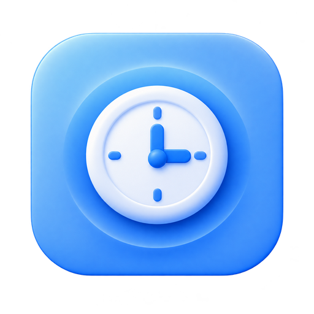
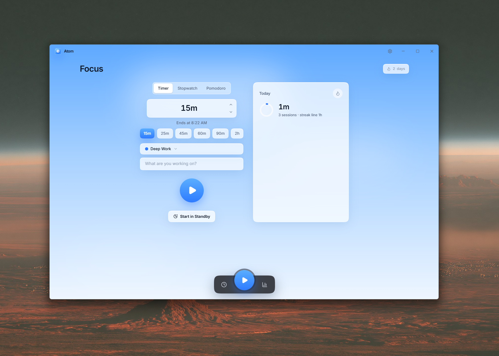
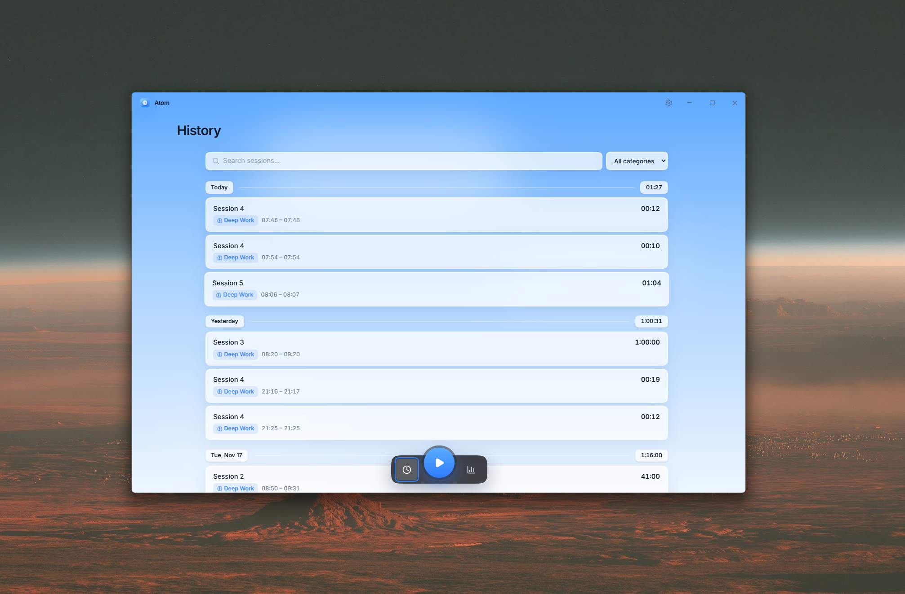
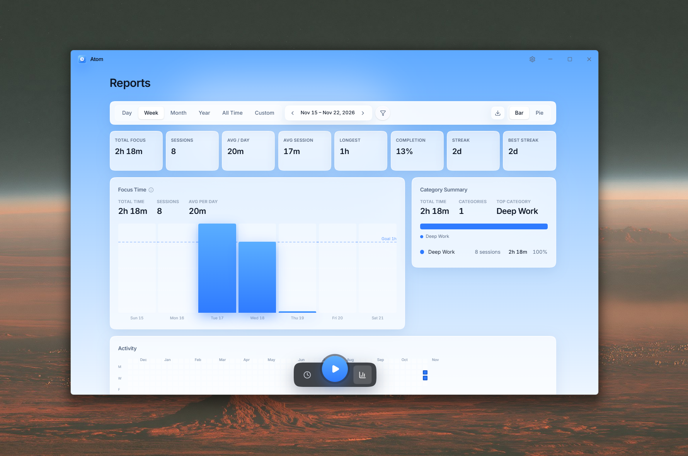

<div align="center">



# Atom

**A calm, local-first focus timer and time tracker for Windows.**

Deep work, measured. No accounts, no cloud, no tracking — your data never leaves your machine.

[](#download)
[](https://github.com/samxnotfound/atom/releases)
[](LICENSE)
[](https://tauri.app)

[Download](#download) · [Features](#features) · [Standby images](#standby-images) · [Build from source](#build-from-source) · [Contributing](CONTRIBUTING.md)

</div>

<div align="center">
  
  
  
</div>

---

## Why Atom

Most focus apps want an account, a subscription, and a copy of your work history. Atom wants none of that.

It's a ~10 MB native Windows app built on Tauri and Rust, backed by a single SQLite file on your own disk. It starts instantly, runs quietly in a window you can leave open all day, and turns every session into analytics you actually own.

- **Local-first by design.** SQLite at `%APPDATA%\Atom\atom.db`. Export everything to CSV, JSON, or PDF whenever you like.
- **Precise timers.** Elapsed time is computed from timestamps, not tick counting — accurate through sleep, lag, and window throttling.
- **One thing per screen.** A timer setup page, a full-screen Standby mode, and a reports dashboard without clutter.

---

## Download

Grab the latest installer from **[GitHub Releases](https://github.com/samxnotfound/atom/releases/latest)**.

| File | Use it when |
| --- | --- |
| `Atom_<version>_x64-setup.exe` | **Recommended.** NSIS installer, per-user, no admin prompt. |
| `Atom_<version>_x64_en-US.msi` | You deploy with Group Policy or prefer MSI. |

Requires **Windows 10 or 11 (64-bit)**. WebView2 is already present on Windows 11 and on up-to-date Windows 10.

### A note about SmartScreen

Atom is free and independently built, so the installer is **not code-signed** with a paid certificate. On first run Windows may show:

> **Windows protected your PC** — Microsoft Defender SmartScreen prevented an unrecognized app from starting.

That's expected for a new, unsigned installer. To continue, click **More info → Run anyway**. The app makes no network requests and the source is right here in this repository if you'd rather build it yourself.

---

## Features

### Focus
- Countdown timer, stopwatch, and Pomodoro in one screen.
- Smart duration input that understands `25`, `25m`, `1h30`, `1:30`, `1.5h`, `2h 15m`, with quick chips and ±5 minute nudges.
- Categories with colors and icons, optional task titles with autocomplete from your recent work.
- Pause, resume, +5 minutes, stop and save, or discard.
- Crash-safe: the running session survives a restart and offers **Resume** or **Save what was tracked**.

### Standby Mode
A distraction-free full-screen timer over a full-bleed photo. Only the clock is visible; controls fade in as a small glass pill when you move the mouse. It keeps the screen awake while active, rotates to a different image every time you enter, and returns to the timer untouched on `Esc`.

### Timeline and History
- A week strip plus an hourly day grid; add manual entries by clicking an empty hour.
- Sessions as soft pastel blocks tinted with the category color.
- History grouped by Today / Yesterday / date with day totals, search, and category filters.

### Reports
Total focus time, session counts, streaks, and category breakdowns across Day, Week, Month, Year, All time, or a custom range. Export to **CSV, JSON, or PDF**.

### Streaks
A day counts when you focus **one hour or more**. Freezes protect the streak when life gets in the way.

### Your data
- Daily rolling JSON backups to `%APPDATA%\Atom\backups\` — the last 14 are kept.
- Backups can be re-imported; the exact database path is shown in Settings → Data with an **Open folder** button.
- Optional one-click demo data, only if you want to see the app filled in.

---

## Standby images

Atom intentionally ships with no photographs. The pretty pictures on your screen should be yours, and bundling stock photos would mean shipping assets with unclear redistribution rights.

**To add your own:**

1. Open **Settings → Standby**.
2. Click **Add images…** and multi-select your photos.
3. Atom copies them into `%APPDATA%\Atom\standby\` — your originals are never modified or deleted.

Recommended: 16:9 landscape, **2560×1440 or larger**, JPG or WebP, under ~3 MB each. Up to **40 images**, shuffled so you never see the same one twice in a row.

With no images added, Standby falls back to a built-in drifting **Sky gradient**, so the feature is fully usable out of the box. You can also change the clock weight and size, and dim the backdrop, from the same settings panel.

---

## Build from source

**Prerequisites**

- [Node.js](https://nodejs.org) 22 or newer
- [Rust](https://rustup.rs) stable toolchain (`rustup default stable`)
- **Microsoft C++ Build Tools** with the *Desktop development with C++* workload
- WebView2 runtime (preinstalled on Windows 11)

```bash
git clone https://github.com/samxnotfound/atom.git
cd atom
npm ci
```

Run it in development:

```bash
npm run tauri dev
```

Produce an installer:

```bash
npm run tauri build
# artifacts land in src-tauri/target/release/bundle/
```

Useful scripts:

| Command | What it does |
| --- | --- |
| `npm run dev` | Vite dev server only (UI in a browser, Tauri APIs unavailable) |
| `npm run build` | Type-check and build the frontend |
| `npm test` | Run the Vitest unit suite |
| `npm run tauri dev` | Full desktop app with hot reload |
| `npm run tauri build` | Signed-free release installer for your machine |

The first Rust build takes a while; later builds are cached.

---

## Contributing

Issues and pull requests are welcome — see [CONTRIBUTING.md](CONTRIBUTING.md) for setup, style, and the PR checklist. If you found a vulnerability, please follow [SECURITY.md](SECURITY.md) instead of opening a public issue.

**Support the project:** [Donate via Wise](https://wise.com/pay/r/ezDx0WhvxuML0rk)

---

## License

[MIT](LICENSE) © 2026 Samarth

Atom is an independent project and is not affiliated with or endorsed by any other productivity app.
